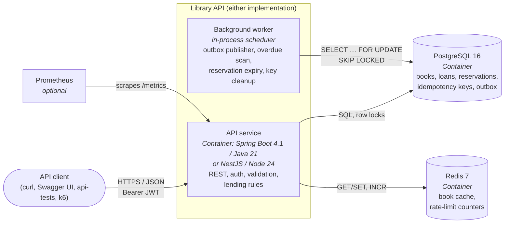
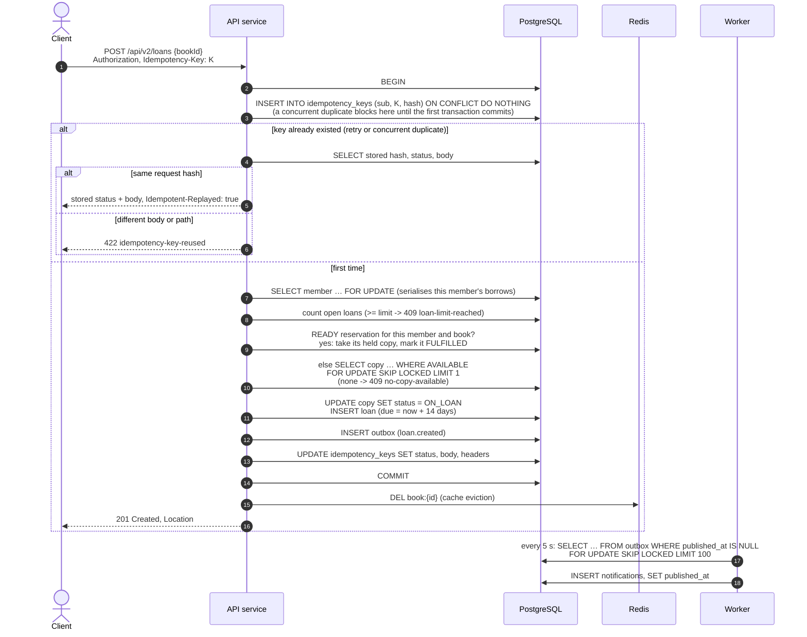

# Library API: one contract, two implementations, one test suite

[](https://github.com/AleksandarStojanovic91/library-api/actions/workflows/ci.yml)


[](LICENSE)

A small lending-library backend (books, copies, members, loans, reservations) built twice from the same
OpenAPI contract: once in **Java 21 / Spring Boot** and once in **TypeScript / NestJS**. A single black-box test
suite runs unchanged against both. If both pass, a client cannot tell which one it is talking to.

The domain is deliberately small so the interesting parts get the attention:

- **Contract first.** `contract/openapi.yaml` is written by hand and is the source of truth. Both services
  serve it at `/openapi.yaml` and `/docs`; the test suite generates its types from it and validates every
  response against it.
- **Correct under concurrency.** Two people borrowing the last copy at the same moment, a client retrying a
  request after a timeout, a returned copy that someone is waiting for: each has a test that fires the requests
  at the same time and checks the result.
- **Production habits.** Problem details for every error, ETags and optimistic locking, idempotency keys,
  cursor pagination, rate limiting, a transactional outbox, structured logs with request ids, Prometheus
  metrics, health probes, API versioning with deprecation headers, CI with load-test thresholds.

## What this project shows

| | Where to look |
|---|---|
| **Contract-first API design**: hand-written OpenAPI 3.1, linted in CI, served by both services | [contract/openapi.yaml](contract/openapi.yaml), [ADR 0001](docs/adr/0001-contract-first-openapi.md) |
| **The same behaviour in two stacks**: Java 21 / Spring Boot 4.1 / JdbcClient and TypeScript / NestJS 11 / Fastify / Drizzle, both hexagonal | [java/](java/README.md), [ts/](ts/README.md), [ADR 0003](docs/adr/0003-hexagonal-architecture.md) |
| **Correctness under concurrency**: row locks, `SKIP LOCKED`, idempotency keys, a transactional outbox, each with a race test | [Borrowing a book](#borrowing-a-book), [ADR 0005](docs/adr/0005-pessimistic-row-locks-and-skip-locked-for-lending.md)-[0007](docs/adr/0007-transactional-outbox.md) |
| **Black-box testing that proves interchangeability**: one Playwright API suite, every response validated against the contract | [api-tests/](api-tests/README.md) |
| **Production habits**: RFC 9457 problem details, ETags, keyset pagination, rate limiting, API versioning with Deprecation/Sunset, metrics, health probes | [docs/SPEC.md](docs/SPEC.md), [docs/architecture.md](docs/architecture.md) |
| **Delivery**: Docker Compose, GitHub Actions (contract lint, both builds, the suite against both, k6 with thresholds), Dependabot | [CI](#ci), [perf/](perf/README.md) |

Companion project: [llm-eval-lab](https://github.com/AleksandarStojanovic91/llm-eval-lab), an evaluation harness for an LLM
library assistant whose tools call this API.

## Quick start

Requirements: Docker with Compose v2. Node 24 for the test suite.

```bash
docker compose up --build            # Java on :8081, TypeScript on :8082, Postgres, Redis
# or, for running the tests and k6 (raises the rate limit, waits until both are ready):
make up
```

| | Java / Spring Boot | TypeScript / NestJS |
|---|---|---|
| API | http://localhost:8081 | http://localhost:8082 |
| Swagger UI (shared contract) | http://localhost:8081/docs | http://localhost:8082/docs |
| Contract | http://localhost:8081/openapi.yaml | http://localhost:8082/openapi.yaml |
| Health | http://localhost:8081/health/ready | http://localhost:8082/health/ready |
| Metrics | http://localhost:8081/metrics | http://localhost:8082/metrics |

`docker compose --profile obs up` also starts Prometheus on http://localhost:9090, scraping both.

### Demo users (seeded by `db/migrations/V2__seed.sql`)

| E-mail | Password | Role |
|---|---|---|
| `librarian@library.test` | `librarian-pass-123` | LIBRARIAN |
| `member@library.test` | `member-pass-123` | MEMBER |
| `member2@library.test` | `member2-pass-123` | MEMBER |

Five books are seeded too (Clean Code, Designing Data-Intensive Applications, Domain-Driven Design, TDD by
Example, The Bridge on the Drina) with one to three copies each.

### Try it with curl

```bash
API=http://localhost:8081      # or :8082, same answers

# search (public): full text, then typo-tolerant fallback
curl -s "$API/api/v1/books?q=kleppmann" | jq '.data[].title'
curl -s "$API/api/v1/books?q=Clen%20Cdoe" | jq '.data[].title'

# log in as a member
TOKEN=$(curl -s -X POST "$API/api/v1/auth/token" -H 'Content-Type: application/json' \
  -d '{"email":"member@library.test","password":"member-pass-123"}' | jq -r .accessToken)

# borrow Clean Code; repeating the same Idempotency-Key replays the first answer instead of borrowing twice
KEY=$(uuidgen)
curl -si -X POST "$API/api/v2/loans" -H "Authorization: Bearer $TOKEN" -H "Idempotency-Key: $KEY" \
  -H 'Content-Type: application/json' -d '{"bookId":"20000000-0000-4000-8000-000000000001"}'
curl -si -X POST "$API/api/v2/loans" -H "Authorization: Bearer $TOKEN" -H "Idempotency-Key: $KEY" \
  -H 'Content-Type: application/json' -d '{"bookId":"20000000-0000-4000-8000-000000000001"}' | grep -i idempotent-replayed

# my loans (v2), and the deprecated v1 view with its Deprecation / Sunset headers
curl -s "$API/api/v2/loans" -H "Authorization: Bearer $TOKEN" | jq '.data[] | {id, status, dueAt}'
curl -si "$API/api/v1/loans" -H "Authorization: Bearer $TOKEN" | grep -iE 'deprecation|sunset|link'

# conditional requests: 304 when unchanged
curl -si "$API/api/v1/books/20000000-0000-4000-8000-000000000001" -H 'If-None-Match: "1"' | head -1

# errors are RFC 9457 problem details with a stable code
curl -s "$API/api/v1/books/00000000-0000-4000-8000-00000000dead" | jq
```

## The shared test suite

`api-tests/` is a Playwright Test suite (API only, no browser). It is the part of the project that proves the
two implementations are interchangeable. See [api-tests/README.md](api-tests/README.md) for the details.

```bash
make up                     # both services, rate limit raised for the parallel suite
cd api-tests && npm ci
npx playwright test --project=java      # 260 tests against :8081 (one, the 429 test, is opt-in)
npx playwright test --project=ts        # the same 260 tests against :8082
make api-test-time-travel-java          # overdue fees and reservation expiry, via a second instance
                                        # started 15.5 days in the future (CLOCK_OFFSET_SECONDS)
```

Besides its explicit assertions, every response is checked against the OpenAPI schema (Ajv, closed object
schemas) and against the cross-cutting rules in [docs/SPEC.md](docs/SPEC.md): request-id echo, rate-limit
headers, problem-detail fields, deprecation headers, timestamp format.

Performance: [perf/README.md](perf/README.md) (k6 smoke and load tests, p95 < 300 ms, errors < 1 %).

## Test results

Last full run on Docker 29.8 (Docker Desktop), both images built from scratch:

| | Java / Spring Boot | TypeScript / NestJS |
|---|---|---|
| Unit + integration tests (Testcontainers: Postgres 16, Redis 7) | 94 + 70 passed | 62 + 64 passed |
| Shared black-box suite | 259 passed, 1 opt-in (429) | 259 passed, 1 opt-in (429) |
| Time-travel suite (overdue fees, reservation expiry) | 10 / 10 | 10 / 10 |
| Suite stress run (each test 3 times, 16 workers) | no failures, no flakes | no failures, no flakes |
| k6 smoke: p95 latency, errors | 7.3 ms, 0 % | 7.4 ms, 0 % |
| Docker image (compressed) | 122 MB | 79 MB |

The concurrency tests run against real Postgres row locks: 20 parallel borrows of a two-copy book, 10 parallel
requests with one idempotency key, the loan-limit race and the return-versus-reservation race.

## Repository map

```
contract/openapi.yaml      the API contract (OpenAPI 3.1), source of truth
docs/SPEC.md               behaviour the contract cannot express (both services must match it)
docs/architecture.md       design: layers, data model, concurrency, caching, scaling
docs/adr/                  architecture decision records 0001-0009
docs/OPEN-QUESTIONS.md     contradictions and gaps found while building the shared parts
db/migrations/             SQL schema and seed data, shared by both services
db/init/                   creates one database per implementation
java/                      Spring Boot implementation (port 8081), see java/README.md
ts/                        NestJS implementation (port 8082), see ts/README.md
api-tests/                 shared black-box suite (Playwright Test, TypeScript)
perf/                      k6 smoke and load tests
ops/prometheus.yml         Prometheus scrape config (compose profile "obs")
docker-compose.yml         local stack
docker-compose.test.yml    test overrides: raised rate limit, time-travel instances
.github/workflows/ci.yml   contract lint, both builds, shared suite against both, k6 smoke
Makefile                   `make help`
```

## Architecture in one page

Both services have the same shape: a stateless HTTP process with the business rules in the middle, Postgres
as the only source of truth, and Redis for things that may be lost (a read cache and rate-limit counters). Each
uses its own database on the same Postgres server so they can run side by side. More in
[docs/architecture.md](docs/architecture.md).



### Borrowing a book

The one write path that has to be right under retries and races. Everything between `BEGIN` and `COMMIT` is a
single database transaction; if anything fails, nothing happened (and a retry with the same key is safe).



Why each piece is there is explained in the ADRs: [idempotency keys in Postgres](docs/adr/0006-idempotency-keys-in-postgres.md),
[row locks and SKIP LOCKED](docs/adr/0005-pessimistic-row-locks-and-skip-locked-for-lending.md),
[transactional outbox](docs/adr/0007-transactional-outbox.md).

## Decisions

| ADR | Decision |
|---|---|
| [0001](docs/adr/0001-contract-first-openapi.md) | Contract-first OpenAPI 3.1, written by hand |
| [0002](docs/adr/0002-shared-sql-migrations.md) | One set of plain SQL migrations for both services |
| [0003](docs/adr/0003-hexagonal-architecture.md) | Hexagonal architecture (ports and adapters) in both services |
| [0004](docs/adr/0004-keyset-pagination.md) | Keyset (cursor) pagination, never OFFSET |
| [0005](docs/adr/0005-pessimistic-row-locks-and-skip-locked-for-lending.md) | Pessimistic row locks and SKIP LOCKED for lending |
| [0006](docs/adr/0006-idempotency-keys-in-postgres.md) | Idempotency keys stored in Postgres, in the same transaction |
| [0007](docs/adr/0007-transactional-outbox.md) | Transactional outbox for events |
| [0008](docs/adr/0008-api-versioning-and-deprecation.md) | URI versioning with Deprecation and Sunset headers |
| [0009](docs/adr/0009-etag-scope.md) | The book ETag versions the catalogue record, not live availability |

## Documentation

| Document | What it covers |
|---|---|
| [docs/SPEC.md](docs/SPEC.md) | Behaviour the contract cannot express: lending rules, time, errors, caching, concurrency; both services must match it |
| [docs/architecture.md](docs/architecture.md) | Layers, data model, concurrency, caching and how it would scale |
| [docs/adr/](docs/adr/) | Nine architecture decision records (table above) |
| [docs/OPEN-QUESTIONS.md](docs/OPEN-QUESTIONS.md) | Contradictions and gaps found while building, and how each was decided |
| [java/README.md](java/README.md), [java/IMPLEMENTATION-NOTES.md](java/IMPLEMENTATION-NOTES.md) | The Spring Boot service: structure, build, tests, choices where the spec leaves room |
| [ts/README.md](ts/README.md), [ts/IMPLEMENTATION-NOTES.md](ts/IMPLEMENTATION-NOTES.md) | The NestJS service: the same for TypeScript |
| [api-tests/README.md](api-tests/README.md) | The shared black-box suite: projects, schema validation, time travel |
| [perf/README.md](perf/README.md) | k6 smoke and load tests and their thresholds |

## CI

`.github/workflows/ci.yml` runs on every push and pull request:

1. **Contract lint** (Redocly CLI).
2. **Suite static checks**: generated types match the contract, typecheck, offline self-tests.
3. **Java** (`./mvnw verify`) and **TypeScript** (`lint`, `typecheck`, `test`) builds, with integration tests on
   Testcontainers (real Postgres and Redis).
4. **Shared suite** as a matrix over `[java, ts]`: build the image with Docker Compose, wait for
   `/health/ready`, run the 260 tests, then start the time-travel instance and run the overdue/expiry tests and
   the 429 test. The Playwright HTML report (with traces of failed tests) is uploaded as an artifact.
5. **k6 smoke** against both, with thresholds; the summary goes to the job page.

Dependabot keeps Maven, npm, GitHub Actions and Docker images up to date.

## License

[MIT](LICENSE)
