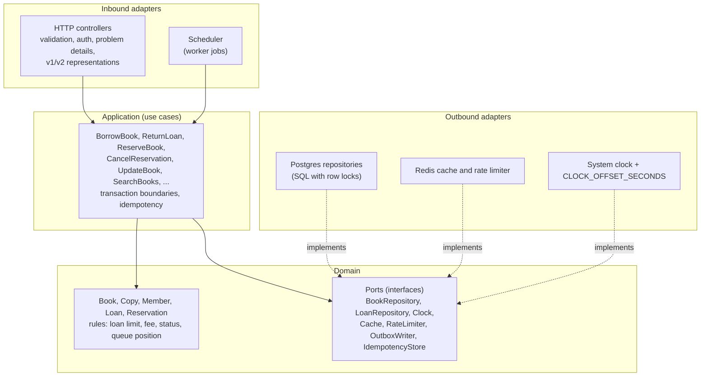
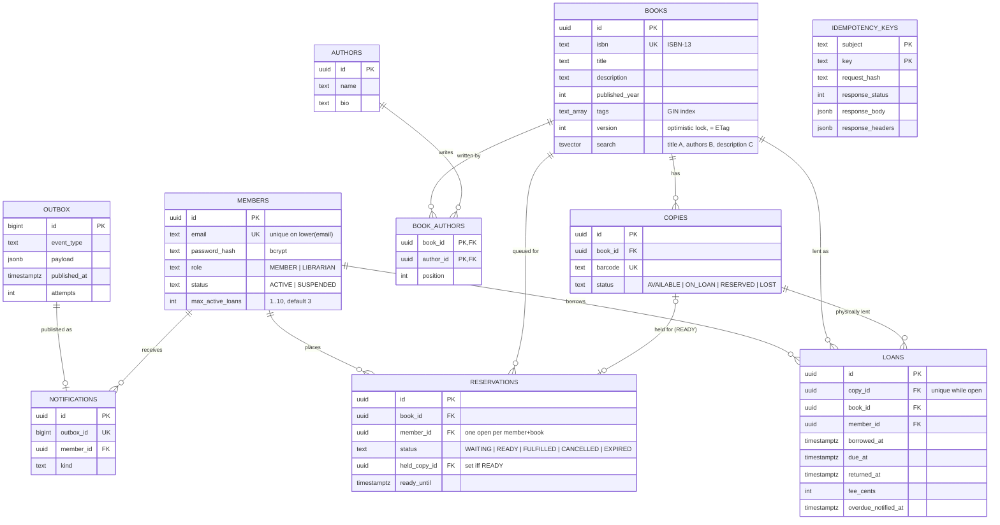

# Architecture

This document explains how the Library API is built and why. It applies to both implementations: the Java and
the TypeScript service have the same layers, the same database and the same behaviour (`docs/SPEC.md`); only
the frameworks differ. Decisions with real alternatives are recorded in `docs/adr/`.

## 1. Goals and constraints

- **Interchangeable implementations.** Anything a client can observe (paths, payloads, status codes, headers,
  error codes, ordering, timing rules) is defined by `contract/openapi.yaml` plus `docs/SPEC.md`, and checked by
  one black-box suite (`api-tests/`).
- **Correct under concurrency and retries.** Lending is a contended resource. The design must hold when two
  requests race for the last copy or a client retries after a timeout.
- **Simple to run.** One `docker compose up`. Postgres is the only stateful dependency that matters; Redis
  holds only data that can be lost.
- **Small, but production-shaped.** No feature exists only for show; each one answers a question a reviewer
  would ask of a real service (what happens on retry, how do you page a big table, how do you retire v1).

## 2. Layers (hexagonal)

Both services use ports and adapters ([ADR 0003](adr/0003-hexagonal-architecture.md)). Dependencies point inwards:
the domain knows nothing about HTTP, SQL or Redis.



What lives where:

| Layer | Responsibility | Must not |
|---|---|---|
| HTTP adapter | parse and validate input against the contract, map identities from the JWT, map domain errors to problem codes, choose the v1 or v2 representation, set headers (ETag, Location, Deprecation) | contain business rules |
| Application | one class/function per use case; opens the transaction, takes locks in a fixed order, writes the outbox row, evicts the cache after commit | know about HTTP status codes |
| Domain | pure rules: can this member borrow, what is the fee, what is the loan status at time *t* | do I/O or read the system clock directly |
| Outbound adapters | SQL, Redis, clock | decide business outcomes |

The `Clock` port is what makes time travel possible: business logic asks the clock for "now", and the adapter
returns `system time + CLOCK_OFFSET_SECONDS`. Tests start a second instance in the future instead of waiting
14 days.

## 3. Data model

One schema, shared by both services (`db/migrations/V1__schema.sql`, [ADR 0002](adr/0002-shared-sql-migrations.md)).
Invariants that must never break live in the database, not only in code.



Constraints worth pointing out:

| Constraint | Protects against |
|---|---|
| `ux_loans_open_copy`: unique `copy_id` where `returned_at IS NULL` | the same copy on two open loans, even if application locking had a bug |
| `ux_reservations_open`: unique `(book_id, member_id)` where status is WAITING or READY | duplicate places in the queue (409 `already-reserved`) |
| `CHECK ((status = 'READY') = (held_copy_id IS NOT NULL AND ready_until IS NOT NULL))` | a READY reservation without a held copy, or a held copy on a WAITING one |
| `notifications.outbox_id UNIQUE` | publishing one event twice when two workers race |
| `books.version` | lost updates on concurrent edits (ETag / If-Match) |

Search: `books.search` is a weighted `tsvector` kept current by triggers on `books` and `book_authors`, queried
with `websearch_to_tsquery('simple', q)` and ranked. When full text finds nothing and the query has at least 3
characters, a trigram index on `title` (`pg_trgm`) gives typo tolerance (`title % q`).

## 4. Consistency and concurrency

All writes run at Postgres' default isolation level, READ COMMITTED, with explicit row locks where two
transactions can collide. This is cheaper and more predictable than SERIALIZABLE with retries, and every lock is
visible in the code ([ADR 0005](adr/0005-pessimistic-row-locks-and-skip-locked-for-lending.md)).

### Borrow (`POST /loans`)

1. Insert the idempotency key row first ([ADR 0006](adr/0006-idempotency-keys-in-postgres.md)). A concurrent
   request with the same key blocks on that row and replays the stored response once the first one commits.
2. `SELECT … FROM members WHERE id = ? FOR UPDATE`: one member's borrows are serialised, so the open-loan count
   cannot be read by two transactions at once (the loan limit holds under parallel requests).
3. A READY reservation of this member for this book? Then take its held copy.
4. Otherwise `SELECT id FROM copies WHERE book_id = ? AND status = 'AVAILABLE' FOR UPDATE SKIP LOCKED LIMIT 1`.
   Two members borrowing the same book never wait for each other and never get the same copy: the second one
   skips the row the first one locked and takes the next copy, or finds none (409 `no-copy-available`).
5. Update the copy, insert the loan and an outbox row, store the response on the idempotency row, commit.
   Evict the cache after commit.

### Return and the reservation queue

Everything that decides who gets a returned or released copy (`POST /loans/{id}/return`,
`POST /reservations`, `DELETE /reservations/{id}` and the reservation-expiry job) first locks the **book row**
(`SELECT … FROM books WHERE id = ? FOR UPDATE`, SPEC "Decisions" 6). That makes the per-book queue a critical
section:

- Returning then locks the loan (a second concurrent return sees `returned_at` set and gets 409
  `already-returned`) and the copy, and looks at the first WAITING reservation (`ORDER BY created_at, id`). If there
  is one, the copy becomes RESERVED and the reservation READY with `ready_until = now + 48 h`; otherwise the copy
  becomes AVAILABLE.
- Creating a reservation re-checks "no copy is AVAILABLE" under the same lock, so it cannot interleave with a
  return and leave a member WAITING next to an AVAILABLE copy (a lost wake-up). The shared suite races a return
  against two reservations for exactly this case.
- Borrowing does **not** take the book lock: it keeps `FOR UPDATE SKIP LOCKED` on copies, so borrows of
  different copies of the same book never block each other.

Lock order, to rule out deadlocks: queue paths take the book row first (after a plain read to find the book
id), then the loan or reservation the request is about, then the copy, then the next WAITING reservation.
A borrow takes the member row, then the member's own READY reservation (if any), then a copy; it never waits for
a book row, so it cannot close a cycle with the queue paths.

### Books: optimistic locking

Editing a book is rare and never contended in practice, so it uses optimistic locking instead of row locks.
`version` is the ETag. `PATCH` requires `If-Match` (428 without it) and runs
`UPDATE books SET … , version = version + 1 WHERE id = ? AND version = ?`. Zero rows updated means someone else
changed it first: 412. Five parallel PATCHes with the same `If-Match` produce exactly one 200.

### Deleting books keeps history

Loans are history and are never cascaded away (SPEC "Decisions" 1). `DELETE /books/{id}` gives 409
`book-has-active-loans` while a copy is ON_LOAN or RESERVED, 409 `book-has-loan-history` if the book was ever
lent, and 204 only for a book that never left the shelf.

### Events: transactional outbox

State changes that other systems care about (`loan.created`, `loan.returned`, `loan.overdue`,
`reservation.ready`, `reservation.expired`) are written to the `outbox` table in the same transaction as the
change ([ADR 0007](adr/0007-transactional-outbox.md)). There is no moment where the loan exists but the event
does not, or the other way round. The worker publishes them (here: into `notifications`, standing in for e-mail
or a broker) and marks them published.

### Background worker

Runs in-process every `WORKER_INTERVAL_MS` (5 s): overdue scan, expiry of READY reservations, outbox publishing,
idempotency-key cleanup. Each job claims rows with `FOR UPDATE SKIP LOCKED` and is idempotent
(`overdue_notified_at`, `published_at`, the unique `notifications.outbox_id`), so any number of instances can run
it at the same time without coordination or a leader election.

## 5. Caching

| What | Where | TTL | Invalidation |
|---|---|---|---|
| `GET /api/v1/books/{id}` representation | Redis key `book:{id}` | 60 s | deleted after commit of any write to the book, its copies, or loans/reservations that change a copy's status |

- Only the single-book read is cached. It is the hottest read and has an obvious key; lists and search results
  have unbounded key spaces and are cheap with the right indexes.
- The cache is *look-aside*: read from Redis, on miss read from Postgres and store. Writes evict the key
  after the transaction commits (evicting before commit could let a concurrent reader put the old value
  back). The 60 s TTL bounds any staleness left by a crash between commit and eviction.
- `X-Cache: HIT|MISS` makes the behaviour testable from outside.
- **Redis is optional at runtime.** If it is down, reads go to Postgres, a warning is logged, readiness stays
  200 with `checks.redis: DOWN`. Losing the cache costs latency, not correctness.

## 6. Rate limiting

Fixed window per minute in Redis: `INCR rl:{subject or IP}:{epochMinute}` with a 60 s expiry. Authenticated
requests are counted per member (`sub`), anonymous ones per client IP. Every response carries `RateLimit-Limit`,
`RateLimit-Remaining` and `RateLimit-Reset`; over the limit gives 429 `rate-limited` with `Retry-After`. Health
and metrics are exempt so probes and scrapers are never throttled.

Trade-offs, chosen on purpose:

- A fixed window allows a burst of up to 2× the limit across a window boundary. A sliding window or token
  bucket (a small Lua script) fixes that; for this API the simpler version is good enough.
- If Redis is down the limiter **fails open** (allows the request). For a library catalogue, availability
  matters more than strict throttling; an API that sells something might choose the opposite.
- Behind a load balancer the client IP must come from a trusted `X-Forwarded-For`, otherwise every anonymous
  client shares one bucket.

## 7. Observability

- **Logs:** one JSON line per request with `method`, `path` (route template, not the raw URL, so ids do not
  explode cardinality), `status`, `durationMs`, `requestId`, `memberId`. No request bodies, no tokens.
- **Request ids:** `X-Request-Id` is echoed if the client sent a sane one (8-100 chars of `[A-Za-z0-9-_]`),
  generated otherwise, returned on every response and copied into every problem body. The test suite sends its
  own ids, so a failing test points straight at the log line.
- **Metrics (Prometheus, `/metrics`):** `http_server_requests` histogram by method, route and status;
  `library_loans_borrowed_total`, `library_loans_returned_total`; `library_outbox_backlog` (a growing backlog
  means the publisher is stuck).
- **Tracing:** OpenTelemetry, exported over OTLP when `OTEL_EXPORTER_OTLP_ENDPOINT` is set.
- **Health:** `/health/live` (process up, for restarts) and `/health/ready` (Postgres reachable, Redis
  reported; 503 only when the database is down, for load-balancer rotation).

## 8. API versioning and deprecation

Versions are in the URI ([ADR 0008](adr/0008-api-versioning-and-deprecation.md)). A new major version is added
only for a breaking change to a representation; additive changes (a new optional field, a new endpoint) stay in
the current version.

Loans are the example: v2 embeds the book and copy and returns the fee as Money instead of integer cents. v1
and v2 share the use cases and differ only in the HTTP adapter that maps the domain object to JSON. Every v1
response, errors included, carries:

```
Deprecation: @1767225600                       (RFC 9745: deprecated since 2026-01-01)
Sunset: Thu, 31 Dec 2026 23:59:59 GMT          (RFC 8594: may be removed after this)
Link: </api/v2/loans>; rel="successor-version"
```

Policy: a deprecated version keeps working, unchanged, for at least six months after `Deprecation`. Its traffic
is watched through the `http_server_requests` metric (by route), and it is removed after `Sunset` once traffic is
gone.

## 9. Security

- Passwords: bcrypt (cost 10). Login returns the same 401 for an unknown e-mail and a wrong password.
- Tokens: HS256 JWT, 1 hour, claims `sub`, `role`, `email`, `iss`. Only HS256 is accepted (no `alg: none`, no
  algorithm switching). For more than one issuing service, RS256/ES256 with a JWKS endpoint would replace the
  shared secret.
- Suspension: librarians set a member's status with `PUT /members/{id}/status`. A SUSPENDED member can still
  log in, read and return books, but borrowing and reserving give 409 `member-suspended`.
- Authorization: librarian-only routes give 403 to members; another member's loan, reservation or profile gives
  404, so ids cannot be probed.
- Input: unknown JSON properties are rejected, sizes are bounded by the contract, all SQL is parameterised.
- Errors never include stack traces (the suite checks every problem body for them).

## 10. Scaling

### Today

The services are stateless: no session, no in-memory state that matters (the cache and rate-limit counters
are in Redis, everything else in Postgres). Any number of instances can run behind a load balancer, and the
background jobs are safe to run on all of them because each job claims its rows with `SKIP LOCKED`.

Reads scale through indexes (keyset pagination stays fast on deep pages, see
[ADR 0004](adr/0004-keyset-pagination.md)) and the book cache. Writes are short transactions that lock a
handful of rows; contention is per member and per book, never global.

### What would change at 100x load

| Pressure | Change |
|---|---|
| Connections: 100 instances × pool of 10 overwhelms Postgres | PgBouncer in transaction mode in front of Postgres; smaller pools per instance |
| Read traffic (catalogue, search) | Postgres read replicas for list/search queries (they tolerate a second of lag); keep loans and reservations on the primary. Cache list pages for anonymous users for a few seconds |
| Search quality and load | Move full-text search to OpenSearch/Elasticsearch, fed from the outbox; Postgres stays the source of truth |
| Hot books (a bestseller with hundreds of borrowers) | Already fine: `SKIP LOCKED` spreads borrowers over copies. The reservation queue for one book becomes the hot spot; partitioning the queue table by book or moving queue position to a counter column would help |
| Outbox throughput | Publish to a real broker (Kafka/SQS) instead of `notifications`; run the publisher as its own deployment; partition the outbox by `aggregate_id` so publishers can work in parallel while keeping per-loan order |
| Background jobs on every instance | Fine for correctness, wasteful at scale: run the worker as a separate, small deployment |
| Idempotency table growth | Partition `idempotency_keys` by day and drop old partitions instead of `DELETE` |
| Rate limiting | Token bucket in Redis with a Lua script; Redis Cluster; enforce coarse limits at the API gateway as well |
| Multi-region | One primary region for writes (lending needs a single source of truth per copy); read-only catalogue served from regional replicas and CDN |

What would *not* change: the contract, the locking strategy and the outbox. They are the parts that are hard to
retrofit, which is why they are in place from the start.

## 11. Testing strategy

| Level | Where | Purpose |
|---|---|---|
| Unit | `java/`, `ts/` | domain rules (fee, status, limits) with a fixed clock |
| Integration | `java/`, `ts/` | repositories and transactions against a real Postgres |
| Shared black-box suite | `api-tests/` | the same 259 HTTP tests against both services; every response validated against the contract and the SPEC |
| Time travel | `api-tests/tests/time-travel` | overdue fees and reservation expiry, using a second instance with a shifted clock |
| Performance | `perf/` | k6 smoke in CI (p95 < 300 ms, errors < 1 %); load test on demand |
