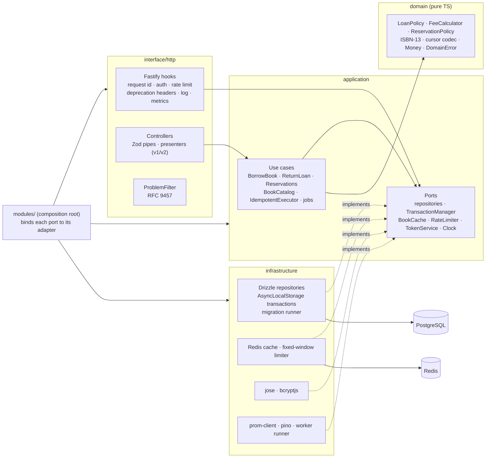

# Library API: TypeScript implementation

NestJS 11 on Fastify, Drizzle ORM on PostgreSQL 16, Redis 7. This is one of two interchangeable implementations of
[`contract/openapi.yaml`](../contract/openapi.yaml) and [`docs/SPEC.md`](../docs/SPEC.md). The Java service
does the same thing in Spring Boot, and both must pass the same black-box suite in [`api-tests/`](../api-tests).

| | |
|---|---|
| Runtime | Node.js 24 LTS (`engines: >=22.12`; CommonJS output, `require(esm)` loads `jose`) |
| HTTP | NestJS 11.2 + `@nestjs/platform-fastify` (Fastify 5.12) |
| Data | Drizzle ORM 0.45 + node-postgres 8; shared SQL migrations run by a small runner |
| Validation | Zod 4, checked against types generated by openapi-typescript 7 from the contract |
| Auth | HS256 JWT with `jose` 6, passwords with `bcryptjs` 3 |
| Cache, rate limit | ioredis 6 |
| Observability | pino 10 via nestjs-pino, prom-client 15, OpenTelemetry SDK (only when `OTEL_EXPORTER_OTLP_ENDPOINT` is set) |
| Tests | Vitest 4, Testcontainers 12 (`postgres:16-alpine`, `redis:7-alpine`) |
| Quality gates | TypeScript 5.9 strict, ESLint 10 + typescript-eslint (type-aware), dependency-cruiser layer rules |

## Running it

```bash
# whole stack from the repository root: Java on :8081, TypeScript on :8082
docker compose up --build

# or only this service, against the compose Postgres/Redis
docker compose up -d postgres redis
cd ts && npm ci && npm run start:dev          # http://localhost:8082/docs
```

Swagger UI at `/docs` renders the shared contract, and `/openapi.yaml` serves it byte for byte. Demo users
(from `db/migrations/V2__seed.sql`):

```bash
curl -s localhost:8082/api/v1/auth/token -H 'content-type: application/json' \
  -d '{"email":"member@library.test","password":"member-pass-123"}'
```

Configuration is environment only, with the variables and defaults from SPEC.md (`PORT=8082`,
`DATABASE_URL=…/library_ts`, `REDIS_URL=redis://localhost:6379/1`, `CLOCK_OFFSET_SECONDS`, …). There are three
additions: `DATABASE_POOL_MAX` (10), `LOG_LEVEL` (info), and `WORKER_INTERVAL_MS=0` to switch the in-process
worker off. `RATE_LIMIT_NAMESPACE` (default `rl`) prefixes the rate-limit keys (SPEC Decisions 23). `MIGRATIONS_DIR` and `CONTRACT_PATH` default to the repository's `db/migrations` and
`contract/openapi.yaml`.

| Script | What it does |
|---|---|
| `npm run lint` | ESLint (type-aware) **and** dependency-cruiser, which fails the build when a layer imports the wrong way |
| `npm run typecheck` | `tsc` over sources and tests, including the compile-time contract checks |
| `npm run test:unit` | domain policies, cursor codec, ETags, request hashing, use cases with fakes, Zod-vs-contract drift test |
| `npm run test:integration` | the whole app in-process (`app.inject`) against real Postgres and Redis containers; needs Docker |
| `npm test` | both |
| `npm run generate:contract` / `check:contract` | regenerate or verify `src/generated/openapi.ts` from the contract |
| `npm run ci` | contract check, lint, typecheck, unit tests, build |

`TEST_DATABASE_URL` + `TEST_REDIS_URL` point the integration tests at existing servers instead of
Testcontainers. Every test creates its own books and members, so a shared database works too.

## Architecture

Ports and adapters inside Nest modules. Dependencies point inwards, and `npm run lint` enforces that with
dependency-cruiser (`.dependency-cruiser.cjs`).



```
src/
  domain/          entities, value objects, policies; no imports outside itself
  application/     use cases (one class per capability), ports + DI tokens, worker jobs
  infrastructure/  db (schema mirror, repositories, transactions, migrator), redis, security, observability
  interface/http/  controllers, Zod schemas, problem details, auth guard, Fastify hooks, presenters
  modules/         Nest modules wiring ports to adapters
  generated/       openapi-typescript output (do not edit)
  bootstrap.ts     createApp(): used by main.ts and by the integration tests
```

Some rules that hold across the code:

- **One error type.** Every layer throws `DomainError(code, message, fieldErrors)`. Only the HTTP layer knows
  that `no-copy-available` means 409 and what its fixed title is.
- **Representations are typed by the contract.** Presenters return `components['schemas']['Loan']` and so on, and
  the Zod request schemas carry a compile-time assertion that their input type *equals* the generated contract
  type. `test/unit/contract-consistency.test.ts` also compares min/max/pattern/required/`additionalProperties`
  with the YAML.
- **Cross-cutting HTTP concerns are Fastify hooks, not Nest interceptors.** Interceptors do not run for unknown
  routes, unparsable bodies, guard rejections or 429s, yet every one of those responses needs `X-Request-Id`,
  `RateLimit-*`, the v1 deprecation headers, a log line and a metric.
- **Three clocks, on purpose.** Business time (`Clock`, shifted by `CLOCK_OFFSET_SECONDS`) drives due dates, fees,
  overdue status and hold expiry. JWT `iat`/`exp` use real time. Audit and retention timestamps
  (`reservations.created_at`, idempotency key age) use the database clock, so a time-shifted instance that
  shares the database cannot reorder queues or wipe keys that other instances still need.

## Key decisions

### Locking (ADR 0005)

| Operation | Locks, in order (member → book → reservation → copy → loan) |
|---|---|
| Borrow | member row `FOR UPDATE` (serialises one member's borrows, so the loan limit holds) → own READY reservation `FOR UPDATE` → its held copy, **or** one AVAILABLE copy with `FOR UPDATE SKIP LOCKED` |
| Return | read loan unlocked → book row (queue lock) → loan `FOR UPDATE`, re-check → head of queue `FOR UPDATE` → copy |
| Reserve | book row (queue lock) → re-check "no AVAILABLE copy" → insert |
| Cancel, expire hold | read reservation unlocked → book row (queue lock) → reservation `FOR UPDATE`, re-check → copy |
| Delete book | book row `FOR UPDATE` (waits for in-flight borrows) → all its copies `FOR UPDATE` |

- `SKIP LOCKED` lets 20 parallel borrows of a 2-copy book lock *different* copies without queueing behind each
  other. Exactly two win, and the rest get `no-copy-available` at once. `ux_loans_open_copy` is the database's
  last line of defence.
- The book row is the **queue lock**. Every decision between "hold the copy for the next reservation" and "put it
  back on the shelf" happens under it, and so does the reservation-time check, so a reservation can never sit
  WAITING next to an AVAILABLE copy. It is taken as `FOR NO KEY UPDATE`. That conflicts with every other queue
  operation but not with the `KEY SHARE` lock a loan insert's foreign key check takes, so borrowing never waits
  for a return (see `NOTES-for-maintainer.md`).
- The fixed lock order is what rules out deadlocks. Operations that start from a loan or a reservation read the
  `book_id` without a lock first and re-check the row after locking.

### Keyset pagination (ADR 0004)

- The cursor is base64url JSON of the last row's sort key and id, e.g. `{"t":"clean code","id":"…"}`. It is
  decoded into an exact shape (anything else is 400) before a value reaches SQL.
- Ascending sorts use `(key, id) > (:k, :id)` and descending sorts `(key, id) < (:k, :id)` (SPEC Decisions 13),
  as single row comparisons; the default title order is served by the `(lower(title), id)` index.
  `-publishedYear` sorts on `coalesce(published_year, -1)`, so books without a year come last.
- Postgres keeps microseconds and a JS `Date` only milliseconds. Timestamp keys therefore travel as
  microsecond text (`to_char(… 'US')`); a millisecond cursor could point *before* the last row and repeat it.
  Search rank (`real`) travels as the exact text Postgres printed, for the same reason.
- Search is ranked full text (`websearch_to_tsquery('simple', q)`, `ts_rank DESC, id DESC`). Only when that finds
  nothing (and `q` has 3 or more characters) does a trigram search (`title % q`, `similarity DESC, id DESC`) run.
  The cursor holds (score, id) and records which of the two produced page 1.
- Each list query computes keys in an inlined CTE and builds the full book representation (authors, copy
  counts) only for the rows of the page.

### Idempotency (ADR 0006)

```
BEGIN
  INSERT INTO idempotency_keys … ON CONFLICT DO NOTHING      -- concurrent duplicate blocks here
  SAVEPOINT  -> BorrowBook (all its locks and writes)
     business error (4xx)? ROLLBACK TO SAVEPOINT, keep the problem as the response
  UPDATE idempotency_keys SET response_status/body/headers
COMMIT                                                        -- duplicate wakes up, finds the response, replays it
```

- The hash is `sha256("POST /api/v2/loans " + canonical JSON)`, with keys sorted recursively, so key order does
  not matter. The same key with another body gives 422 `idempotency-key-reused`.
- 4xx responses are stored and replayed (a retry gets the same 409 even if a copy has appeared since). Unexpected
  errors roll back the key row too, so the client can retry. Replays carry `Idempotent-Replayed: true`, and a
  replayed problem keeps its body but gets the current `requestId`.
- Transactions propagate through `AsyncLocalStorage`, and a nested `TransactionManager.run` is a savepoint.
  After-commit hooks (cache eviction, metrics) are dropped with a rolled-back savepoint and run only after the
  outermost commit.

### Transactional outbox (ADR 0007)

`loan.created`, `loan.returned`, `loan.overdue`, `reservation.ready` and `reservation.expired` are written to
`outbox` in the same transaction as the change. The worker runs every `WORKER_INTERVAL_MS` (with `setTimeout`, so
ticks never overlap). It runs the overdue scan (an `UPDATE … FROM (SELECT … FOR UPDATE SKIP LOCKED)`), hold
expiry, then the publisher. The publisher claims 100 rows with `SKIP LOCKED` and delivers each one in its own
savepoint to the `notifications` table, which stands in for e-mail or a broker; `outbox_id` is unique, so an
event is delivered at most once. A failure increments `attempts`, and a message is parked after 10 attempts.
The worker then deletes idempotency keys older than 24 h. Several instances can run the worker safely, because
every step claims its rows with locks.

### Caching and rate limiting

- `GET /books/{id}` is cache-aside in Redis (`book:{id}`, 60 s), with `X-Cache: HIT|MISS`. Writes evict the key
  *after commit*, so a reader cannot re-cache the old row in between. The Redis client never queues commands
  while disconnected (`enableOfflineQueue: false`, 500 ms timeout). During an outage every read is a MISS served
  from Postgres, rate limiting fails open, `/health/ready` reports `redis: DOWN` with 200, and warnings are
  throttled to one per 10 s.
- The rate limiter uses a fixed window: `INCR {RATE_LIMIT_NAMESPACE}:{sub|ip}:{epochMinute}` + `EXPIRE` in one `MULTI`. It runs in
  `onRequest` after token verification, so authenticated callers get their own budget.

### Operations

- One JSON log line per request (`method, path` = route template, `status, durationMs, requestId, memberId`).
  Application logs carry the same request id through nestjs-pino.
- `/metrics` exposes `http_server_requests_seconds` (histogram by method, route, status),
  `library_loans_borrowed_total`, `library_loans_returned_total`, `library_outbox_backlog` (read at scrape time),
  plus default process metrics.
- On SIGTERM Nest closes the HTTP server (in-flight requests finish, and new ones get 503), stops the worker
  (`beforeApplicationShutdown` waits for a running tick), then closes the pg pool and Redis. A 20 s timer is the
  backstop.
- Migrations run on start under a Postgres advisory lock, one transaction per file, with checksums recorded in
  `schema_migrations`. Several instances can start at once, and a file edited after it was applied stops the start.
- Image: multi-stage `node:24-alpine`, `npm ci --omit=dev`, non-root `node` user, `HEALTHCHECK` on
  `/health/live`, and the shared migrations and contract copied in (build context is the repository root).

## Tests

- **Unit** (`test/unit`, no I/O): ISBN-13, fee and loan status rules, reservation holds, Money, cursor codec
  (including hostile cursors), ETag parsing, request hashing, problem documents, `IssueToken` and
  `IdempotentExecutor` with in-memory fakes, and Zod schemas against the contract YAML.
- **Integration** (`test/integration`, Testcontainers): borrow, return and fees; loan limit; no copy →
  reservation → hold → borrow; hold expiry and the overdue scan on a second, time-shifted instance sharing the
  database (as the shared suite does); outbox to notifications; 20 parallel borrows of a 2-copy book; the same
  `Idempotency-Key` sent 10 times at once; racing return vs reservation; ETag 304/412/428 and merge patch;
  idempotent replay and 422; auth 401/403/404; v1 deprecation headers; keyset pagination across pages and sort
  orders; search; rate limiting and 429; running with Redis down.
